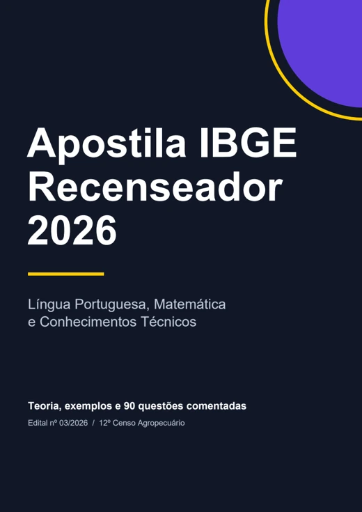

Se você vai fazer a prova de **Recenseador do IBGE**, uma boa forma de começar é entender o programa e testar se consegue aplicar o que leu. A **Apostila IBGE Recenseador 2026**, do Informática para Concurso, reúne **Língua Portuguesa, Matemática e Conhecimentos Técnicos** em um PDF com explicações, exemplos resolvidos e **90 questões autorais com gabarito comentado**.

O preço de lançamento do PDF é **R$ 14,99, em pagamento único**. Enquanto a compra online aguarda liberação, confira o conteúdo dos módulos e resolva uma questão da própria apostila.

[Ver o que vem na apostila](#o-que-vem-na-apostila)

## O que cai na prova de Recenseador do IBGE?

O Edital nº 03/2026 organiza a prova objetiva em três disciplinas. São 60 questões de múltipla escolha, com cinco alternativas por questão.

| Disciplina | Questões na prova | Pontuação máxima |
| --- | ---: | ---: |
| Língua Portuguesa | 15 | 15 |
| Matemática | 15 | 15 |
| Conhecimentos Técnicos | 30 | 30 |
| **Total** | **60** | **60** |

A parte técnica concentra metade dos pontos. Para se preparar, distribua o tempo entre as três matérias e reserve mais blocos para o Censo Agropecuário. O edital exige pelo menos um ponto em cada disciplina e 18 pontos no total para evitar a eliminação por nota. [Edital nº 03/2026 e conteúdo programático](https://ftp.ibge.gov.br/edital/PSS_Censo_Agro/2026_03/EDITAL_03_2026_PSS_RECENSEADOR_IBGE.pdf#page=138)

## O que vem na apostila

Você recebe um **PDF de 41 páginas**, com sumário clicável, três módulos de teoria, exemplos resolvidos e **18 blocos de cinco questões**. O índice de exercícios leva direto ao assunto escolhido, e o gabarito comenta cada resposta no fim da apostila.

### Módulo 1 — Língua Portuguesa

- **Entender o texto.** Diferencie informação expressa e inferência, acompanhe a sequência das ideias e perceba como sinônimos, antônimos e homônimos funcionam na frase.
- **Revisar a escrita.** Veja como a vírgula pode mudar o sentido de uma oração, como identificar a sílaba tônica e como reconhecer a função das classes de palavras.
- **Aplicar a gramática.** Treine concordância nominal e verbal, regência e crase, verbos regulares e irregulares, vozes verbais e emprego e colocação dos pronomes.

Um dos exemplos mostra como duas vírgulas mudam a interpretação de uma frase sobre formulários devolvidos. Você vê como detectar a mudança de sentido antes de responder.

### Módulo 2 — Matemática

- **Montar a conta.** Revise números naturais, inteiros e racionais, operações, frações, múltiplos, divisores e equações do primeiro grau.
- **Resolver problemas de proporção.** Pratique razão, divisão proporcional, regra de três simples e porcentagem, com atenção ao total usado como base.
- **Trabalhar com medidas e interpretar dados.** Revise conversões, área, perímetro e volume. Use os exemplos de gráfico, mapa e croqui para decidir quais informações entram no cálculo.

Um exemplo mostra por que, após aumentar um valor em 20% e reduzi-lo em 20%, o resultado fica abaixo do valor inicial. O PDF também traz um quadro de conversão para comprimento, superfície, volume, massa e tempo.

### Módulo 3 — Conhecimentos Técnicos

Entenda como se organiza a coleta do **12º Censo Agropecuário, Florestal e Aquícola**, quais são as funções da equipe e como se usam o Dispositivo Móvel de Coleta, os mapas e o descritivo do setor. O módulo aborda ainda navegação, endereços, coordenadas, sigilo e registro de ocorrências em campo.

Na parte sobre unidades de produção, você revisa o que caracteriza um **estabelecimento agropecuário**, quando é possível registrar um **produtor sem área** e que critérios se aplicam a estabelecimentos em mais de um setor ou com áreas descontínuas. O PDF traz links para o edital e para o material técnico gratuito da seleção. Leia o documento oficial para consultar os procedimentos completos. [Página da seleção na Fundação Cesgranrio](https://concursos.cesgranrio.org.br/portal/avaliacoes/33)

## Experimente uma questão da apostila

**Questão de Conhecimentos Técnicos**

Um estabelecimento ocupa partes dos setores X e Y. A sede, usada para administrar a atividade, fica dentro do estabelecimento no setor X. O setor Y contém a maior parte das terras. Onde o estabelecimento deve ser recenseado?

- **A)** No setor X, onde fica a sede.
- **B)** No setor Y, por concentrar a maior área.
- **C)** Uma vez em cada setor, dividindo a produção.
- **D)** No setor em que fica a residência habitual do proprietário, em qualquer caso.
- **E)** No setor escolhido pelo informante.

**Gabarito: A.** A sede define o setor de recenseamento neste caso. A maior parte da área só passa a ser o critério de localização quando não há sede.

O PDF inclui **45 questões de Português** (cinco por tópico), **40 de Matemática** (cinco por tópico) e **5 de Conhecimentos Técnicos**. Você pode fazer um bloco por vez e, depois, abrir a correção daquele bloco pelo link da própria página.

## Para quem é esta apostila?

O material foi feito para quem vai disputar a função de **Recenseador do IBGE pelo Edital nº 03/2026** e quer uma revisão direta dos assuntos da prova. Se estiver começando, leia a teoria e refaça os exemplos no papel. Se já estiver estudando, escolha um bloco, responda às cinco questões e volte à teoria dos pontos em que teve dúvida.

## Apostila IBGE Recenseador 2026 por R$ 14,99

O **PDF com os três módulos, exemplos resolvidos e 90 questões autorais com gabarito comentado** terá preço de **R$ 14,99, em pagamento único**. Use o índice de exercícios para escolher o que precisa praticar, como concordância, porcentagem ou leitura de mapas.

**A compra online ainda não está disponível.** O link de compra será disponibilizado nesta página.

## Perguntas frequentes

### A apostila é oficial do IBGE?

É um material independente do Informática para Concurso. O documento oficial de Conhecimentos Técnicos continua disponível gratuitamente na página da seleção. [Documentos da seleção](https://concursos.cesgranrio.org.br/portal/avaliacoes/33)

### As questões são de provas anteriores?

As 90 questões foram elaboradas para esta apostila. Todas têm cinco alternativas, uma resposta correta e um comentário que explica o raciocínio.

### É possível estudar pelo celular?

Sim. O material é um PDF com sumário clicável. Também pode ser aberto no computador ou impresso em papel A4.

### Cai Informática na prova de Recenseador?

O edital prevê Português, Matemática e Conhecimentos Técnicos. O Dispositivo Móvel de Coleta aparece no estudo dos procedimentos de campo. [Anexo III do edital](https://ftp.ibge.gov.br/edital/PSS_Censo_Agro/2026_03/EDITAL_03_2026_PSS_RECENSEADOR_IBGE.pdf#page=138)
