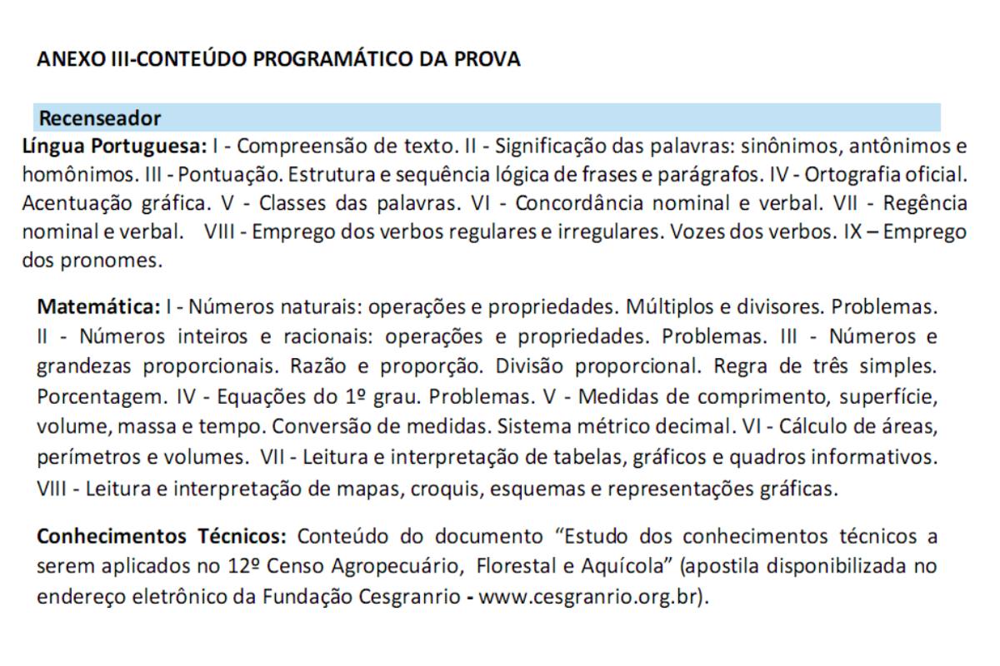

O **conteúdo programático do IBGE Recenseador 2026** está no Anexo III do Edital nº 03/2026. Veja no print os tópicos de Português, Matemática e Conhecimentos Técnicos. Em seguida, use as tabelas e os exemplos para revisar cada matéria.

[Ir direto às 30 questões comentadas](#30-questões-comentadas-para-treinar). São 10 por disciplina, com cinco alternativas e gabarito comentado.

*Fonte: [Anexo III do Edital nº 03/2026 do IBGE](https://ftp.ibge.gov.br/edital/PSS_Censo_Agro/2026_03/EDITAL_03_2026_PSS_RECENSEADOR_IBGE.pdf#page=138).*

| Disciplina | Questões na prova | Parcela da prova |
| --- | ---: | ---: |
| Língua Portuguesa | 15 | 25% |
| Matemática | 15 | 25% |
| Conhecimentos Técnicos | 30 | 50% |

Para saber quem pode concorrer, quanto paga a seleção e quando sai o cartão de confirmação, consulte o [edital do Concurso IBGE 2026, com vagas, remuneração e calendário](/concurso-ibge-2026/).

## Língua Portuguesa

O programa vai da compreensão de texto ao emprego de pronomes. Uma forma de estudar é ler um parágrafo curto e, em seguida, verificar como uma alteração na pontuação ou na ordem das frases muda o sentido.

| O que revisar | Como praticar |
| --- | --- |
| Compreensão de texto e sequência lógica | Destaque a ideia principal e identifique qual frase explica, exemplifica ou contradiz a anterior. |
| Sinônimos, antônimos e homônimos | Substitua uma palavra por outra e confira se o significado se mantém naquele contexto. |
| Pontuação, ortografia e acentuação | Compare frases com e sem vírgulas. Anote a regra por trás de cada erro de escrita. |
| Classes de palavras e emprego de pronomes | Circule cada pronome e identifique a que pessoa, objeto ou ideia ele se refere. |
| Concordância e regência nominais e verbais | Localize o núcleo do sujeito antes de conferir a flexão do verbo. Observe quais palavras exigem preposição. |
| Verbos regulares e irregulares e vozes verbais | Transforme frases da voz ativa para a passiva e verifique quem executa e quem recebe a ação. |

**Exemplo resolvido.** Em “Os formulários que estavam incompletos foram devolvidos”, o trecho “que estavam incompletos” delimita o grupo devolvido. Em “Os formulários, que estavam incompletos, foram devolvidos”, o trecho entre vírgulas acrescenta uma explicação sobre todos os formulários mencionados. Esse tipo de comparação ajuda a resolver questões sobre o efeito da pontuação.

## Matemática

O Anexo III inclui cálculo e interpretação. Antes de fazer uma conta, identifique o dado pedido, a unidade e, nos exercícios de porcentagem, qual total representa 100%.

| O que revisar | Como praticar |
| --- | --- |
| Operações com naturais, inteiros e racionais | Resolva problemas com frações, decimais, números negativos, múltiplos e divisores. |
| Razão, proporção e divisão proporcional | Distribua uma quantidade em partes proporcionais e confira se a soma das partes recupera o total. |
| Regra de três simples e porcentagem | Reescreva o enunciado com a base explícita, como “15% de 240”. |
| Equações do primeiro grau | Represente a quantidade desconhecida por uma letra e substitua o resultado na equação para conferir. |
| Sistema métrico, medidas e conversões | Trabalhe com comprimento, área, volume, massa e tempo. Converta as unidades antes de calcular perímetro, área ou volume. |
| Tabelas, gráficos e quadros informativos | Confira títulos, eixos, unidades e legendas antes de comparar valores. |
| Mapas, croquis, esquemas e outras representações | Marque o ponto de partida, siga o trajeto indicado e use a escala somente quando ela estiver disponível. |

**Exemplo resolvido.** Em um setor com 240 unidades previstas, 36 ainda precisam de visita. O percentual pendente é 36 ÷ 240 × 100 = **15%**. A base é 240 porque o enunciado pede a parcela pendente entre todas as unidades previstas.

## Conhecimentos Técnicos

O Anexo III indica o documento **“Estudo dos conhecimentos técnicos a serem aplicados no 12º Censo Agropecuário, Florestal e Aquícola”**. Use a versão disponibilizada nos documentos do processo seletivo e deixe o edital aberto para consultar as atribuições da função. [Documentos da seleção na Fundação Cesgranrio](https://concursos.cesgranrio.org.br/portal/avaliacoes/33) · [Página do processo seletivo no IBGE](https://www.ibge.gov.br/acesso-informacao/institucional/trabalhe-conosco/48482-2026-03-recenseador.html)

Para transformar a leitura em treino, organize suas anotações em perguntas:

1. **Unidade de coleta.** O que caracteriza um estabelecimento agropecuário? Como o material orienta o registro em situações especiais?
2. **Trabalho em campo.** Quais informações ajudam a localizar a unidade e como o recenseador registra a entrevista no Dispositivo Móvel de Coleta (DMC)?
3. **Qualidade e sigilo.** Como deve ser tratada uma pendência? Por que os dados individuais coletados são protegidos?

Para cada situação, registre o procedimento descrito no documento, o detalhe que muda a decisão e a página onde você encontrou a orientação. Isso facilita revisar os casos em que duas respostas parecem plausíveis.

**Cai Informática?** O edital lista três disciplinas, e Informática não aparece como matéria separada. O uso do DMC entra no contexto do trabalho de campo. Estude o dispositivo a partir do material indicado para a seleção.

## 30 questões comentadas para treinar

São 10 questões por disciplina, com cinco alternativas cada. Responda primeiro e abra o gabarito para conferir o raciocínio.

### Língua Portuguesa — 10 questões

**01. Interpretação de texto**

Leia: “A equipe iniciou as visitas cedo para aproveitar a luz do dia. Depois das chuvas, porém, algumas estradas ficaram intransitáveis e parte das visitas foi adiada.” O que o texto permite concluir?

- **A)** Todas as visitas foram canceladas.
- **B)** O início antecipado evitou os atrasos.
- **C)** As condições das estradas afetaram o planejamento.
- **D)** A chuva ocorreu antes do início das visitas.
- **E)** A equipe visitou apenas unidades urbanas.

Ver gabarito e comentário

**Resposta C.** A segunda frase liga o estado das estradas ao adiamento de parte das visitas. A palavra “parte” impede concluir que todas foram canceladas.

**02. Sentido das palavras**

Em “Após consultar o mapa desatualizado, a equipe precisou retificar o trajeto”, qual palavra mantém o sentido de “retificar”?

- **A)** Confirmar.
- **B)** Corrigir.
- **C)** Repetir.
- **D)** Registrar.
- **E)** Encerrar.

Ver gabarito e comentário

**Resposta B.** Retificar significa corrigir. Ratificar tem sentido diferente: significa confirmar ou validar.

**03. Pontuação**

Em “Os mapas **que tinham divergências** foram revisados”, qual é a função do trecho em destaque?

- **A)** Explicar que todos os mapas tinham divergências.
- **B)** Identificar quais mapas foram revisados.
- **C)** Indicar quando os mapas foram revisados.
- **D)** Informar quem revisou os mapas.
- **E)** Indicar onde as divergências foram registradas.

Ver gabarito e comentário

**Resposta B.** O trecho restringe o grupo aos mapas com divergências. Com vírgulas antes e depois da oração, a informação se aplicaria a todos os mapas mencionados.

**04. Sequência lógica**

Qual opção completa esta sequência de forma coerente? “O recenseador conferiu o endereço no mapa. ______, dirigiu-se ao local indicado.”

- **A)** Apesar disso
- **B)** Em contrapartida
- **C)** Ao contrário
- **D)** Em seguida
- **E)** Em vez disso

Ver gabarito e comentário

**Resposta D.** “Em seguida” apresenta a ação posterior à conferência. As expressões das demais alternativas sugerem oposição ou substituição entre as ações.

**05. Ortografia e acentuação**

Qual alternativa apresenta todas as palavras grafadas corretamente?

- **A)** Relatório, possível, entrevista.
- **B)** Relatorio, possível, entrevista.
- **C)** Relatório, possivel, entrevista.
- **D)** Relatório, possível, entrevizta.
- **E)** Relátorio, possível, entrevista.

Ver gabarito e comentário

**Resposta A.** A sílaba tônica de “relatório” é “tó”. “Possível” recebe acento por ser uma paroxítona terminada em L. “Entrevista” é escrita com S e dispensa acento.

**06. Classes de palavras**

Em “A equipe registrou cuidadosamente as informações”, a palavra “cuidadosamente” pertence a qual classe?

- **A)** Adjetivo.
- **B)** Substantivo.
- **C)** Pronome.
- **D)** Preposição.
- **E)** Advérbio.

Ver gabarito e comentário

**Resposta E.** É um advérbio de modo porque modifica o verbo “registrou” e indica como a equipe realizou o registro.

**07. Concordância**

Qual frase segue a norma-padrão de concordância verbal e nominal?

- **A)** Restou duas pendências no setor.
- **B)** Fazem três dias que a equipe saiu.
- **C)** Foram registradas duas novas ocorrências.
- **D)** Houveram duas visitas de retorno.
- **E)** Segue anexas as fichas preenchidas.

Ver gabarito e comentário

**Resposta C.** “Foram registradas” concorda com “duas novas ocorrências”. Com sentido de tempo decorrido ou de existência, “fazer” e “haver” ficam no singular, como em “faz três dias” e “houve duas visitas”.

**08. Regência e crase**

Qual frase apresenta a regência e o uso do acento grave conforme a norma-padrão?

- **A)** A equipe obedeceu às orientações da supervisão.
- **B)** A equipe obedeceu as orientações da supervisão.
- **C)** O recenseador chegou à pé ao local.
- **D)** A supervisora respondeu à todos os pedidos.
- **E)** A supervisora se referiu à uma ocorrência do setor.

Ver gabarito e comentário

**Resposta A.** “Obedecer” pede a preposição “a”. Ela se junta ao artigo plural “as” de “as orientações”, formando “às”. Em “a pé” e “a todos” não há esse artigo. Também não há fusão de “a” com o artigo indefinido “uma”.

**09. Vozes verbais**

Qual é a versão na voz passiva de “A supervisora revisou os formulários”?

- **A)** Os formulários revisaram a supervisora.
- **B)** Revisaram os formulários da supervisora.
- **C)** A supervisora foi revisada pelos formulários.
- **D)** Os formulários foram revisados pela supervisora.
- **E)** Os formulários seriam revisados pela supervisora.

Ver gabarito e comentário

**Resposta D.** O objeto direto “os formulários” passa a sujeito da passiva. “Pela supervisora” indica quem executou a ação, e “foram revisados” conserva o tempo passado da frase original.

**10. Emprego de pronomes**

Leia: “A coordenadora apresentou o roteiro aos recenseadores. Eles anotaram os horários.” A quem o pronome “eles” se refere?

- **A)** À coordenadora.
- **B)** Aos recenseadores.
- **C)** Ao roteiro.
- **D)** Aos horários.
- **E)** À apresentação.

Ver gabarito e comentário

**Resposta B.** Na segunda frase, “eles” retoma “os recenseadores”, um referente masculino plural já mencionado. “Os horários” aparecem depois como objeto de “anotaram”.

### Matemática — 10 questões

**01. Operações com números naturais**

Uma equipe tinha 148 visitas previstas. Concluiu 37 na segunda-feira e 46 na terça-feira. Quantas ainda faltavam?

- **A)** 55
- **B)** 62
- **C)** 65
- **D)** 73
- **E)** 83

Ver gabarito e comentário

**Resposta C.** As visitas concluídas somam 37 + 46 = 83. Restam 148 − 83 = 65.

**02. Múltiplos comuns**

Duas equipes enviam relatórios a cada 6 e 8 dias, respectivamente. Hoje as duas enviaram relatórios. Daqui a quantos dias voltarão a enviá-los no mesmo dia pela primeira vez?

- **A)** 14
- **B)** 16
- **C)** 18
- **D)** 24
- **E)** 48

Ver gabarito e comentário

**Resposta D.** 24 é o menor múltiplo positivo comum a 6 e 8. Embora 48 também seja múltiplo dos dois, ocorre depois.

**03. Números racionais**

Um recenseador percorre 3/4 km num trecho e 2/3 km no seguinte. Qual é a distância total?

- **A)** 5/7 km
- **B)** 5/12 km
- **C)** 1 km
- **D)** 13/12 km
- **E)** 17/12 km

Ver gabarito e comentário

**Resposta E.** Com denominador 12, as duas parcelas se tornam 9/12 e 8/12. Somando, o resultado é 17/12 km.

**04. Divisão proporcional**

Uma equipe distribuirá 84 visitas entre dois roteiros na proporção de 3 para 4. Quantas visitas vão para o roteiro de maior participação?

- **A)** 48
- **B)** 42
- **C)** 36
- **D)** 32
- **E)** 28

Ver gabarito e comentário

**Resposta A.** A razão tem 7 partes. Cada uma vale 84 ÷ 7 = 12 visitas. O roteiro maior recebe 4 × 12 = 48.

**05. Regra de três simples**

Mantido o ritmo constante, uma equipe visita 18 unidades em 3 horas. Quantas unidades visita em 5 horas?

- **A)** 24
- **B)** 27
- **C)** 30
- **D)** 33
- **E)** 36

Ver gabarito e comentário

**Resposta C.** O ritmo é de 18 ÷ 3 = 6 unidades por hora. Em 5 horas, são 6 × 5 = 30 unidades.

**06. Porcentagem**

Uma equipe concluiu 30% de 200 visitas previstas pela manhã. À tarde, concluiu mais 20% **das visitas que ainda faltavam**. Quantas visitas foram concluídas ao todo?

- **A)** 60
- **B)** 72
- **C)** 80
- **D)** 88
- **E)** 100

Ver gabarito e comentário

**Resposta D.** De manhã foram concluídas 60 visitas, e restaram 140. À tarde, 20% de 140 correspondem a 28 visitas. A soma é 88. A alternativa E usa as 200 iniciais como base para as duas porcentagens.

**07. Equação do primeiro grau**

Uma equipe recebeu 70 formulários. No fim do dia, o número de formulários preenchidos era quatro vezes o de formulários em branco. Quantos ficaram em branco?

- **A)** 10
- **B)** 14
- **C)** 17
- **D)** 28
- **E)** 56

Ver gabarito e comentário

**Resposta B.** Se x é o total em branco, o total preenchido é 4x. Logo, x + 4x = 70 e x = 14. Os 56 restantes foram preenchidos.

**08. Conversão de medidas e área**

Um terreno retangular tem 250 m de comprimento e 80 m de largura. Qual é sua área em hectares? Considere 1 hectare = 10.000 m².

- **A)** 0,2 ha
- **B)** 0,8 ha
- **C)** 1,25 ha
- **D)** 2 ha
- **E)** 20 ha

Ver gabarito e comentário

**Resposta D.** A área é 250 × 80 = 20.000 m². Dividindo por 10.000 m² por hectare, obtêm-se 2 hectares.

**09. Leitura de dados**

Em certo dia, o setor A concluiu 18 de 24 visitas, o setor B concluiu 20 de 40 e o setor C concluiu 15 de 20. Quais setores tiveram a mesma proporção de conclusão?

- **A)** A e B.
- **B)** B e C.
- **C)** A, B e C.
- **D)** Nenhum par.
- **E)** A e C.

Ver gabarito e comentário

**Resposta E.** A e C concluíram 75% de suas respectivas visitas: 18/24 e 15/20 equivalem a 3/4. O setor B concluiu 50%.

**10. Interpretação de mapas**

Em um mapa de escala 1:25.000, dois pontos estão separados por 4 cm em linha reta. Qual é a distância correspondente no terreno?

- **A)** 100 m
- **B)** 250 m
- **C)** 625 m
- **D)** 1 km
- **E)** 10 km

Ver gabarito e comentário

**Resposta D.** Quatro centímetros no mapa correspondem a 4 × 25.000 = 100.000 cm no terreno. Isso equivale a 1.000 m, ou 1 km.

### Conhecimentos Técnicos — 10 questões

Os cenários a seguir se baseiam nas atribuições do item 3.5 do edital. Use-os para revisar os procedimentos de campo e complemente o estudo com o documento indicado no Anexo III.

**01. Cobertura do setor censitário**

Ao organizar as primeiras visitas, o recenseador percebe que algumas unidades do setor ficam longe da via principal. Qual conduta está de acordo com o trabalho de campo?

- **A)** Cobrir o setor atribuído conforme a orientação da supervisão, incluindo as unidades de acesso mais difícil.
- **B)** Visitar somente as unidades abertas na primeira passagem.
- **C)** Concluir a coleta após visitar a maioria do setor.
- **D)** Considerar as unidades afastadas parte de outro setor.
- **E)** Substituir as unidades afastadas por outras mais próximas.

Ver gabarito e comentário

**Resposta A.** A cobertura deve abranger o setor atribuído. A distância da via principal não altera a unidade a ser localizada e visitada, e dificuldades de acesso devem ser tratadas com orientação da supervisão.

**02. Reconhecimento de limites e acessos**

Em campo, o recenseador identifica uma diferença entre o acesso indicado no material cartográfico e o acesso encontrado. Como deve proceder?

- **A)** Alterar por conta própria a delimitação oficial do setor.
- **B)** Usar um setor vizinho para registrar todas as entrevistas da área.
- **C)** Registrar a inconsistência e consultar a supervisão sobre o prosseguimento.
- **D)** Manter a informação como se estivesse confirmada.
- **E)** Excluir as unidades próximas do ponto divergente.

Ver gabarito e comentário

**Resposta C.** O recenseador verifica limites e acessos e registra inconsistências. A supervisão orienta como lidar com a divergência operacional.

**03. Identificação na entrevista**

Antes da entrevista presencial, como o recenseador deve se apresentar ao informante?

- **A)** Apresentar o DMC como único comprovante.
- **B)** Identificar-se com material de identificação fornecido pelo IBGE e manter postura profissional.
- **C)** Pedir primeiro as informações de produção e se identificar ao final.
- **D)** Usar o crachá de outro integrante da equipe.
- **E)** Acionar o supervisor para se identificar em todas as entrevistas.

Ver gabarito e comentário

**Resposta B.** O edital prevê apresentação com uniforme, crachá e documento de identificação fornecidos pelo IBGE. A identificação ajuda o informante a reconhecer a coleta oficial.

**04. Dispositivo Móvel de Coleta**

Qual é o papel do Dispositivo Móvel de Coleta (DMC) durante a entrevista?

- **A)** Funcionar apenas como agenda de visitas.
- **B)** Guardar apenas os endereços, se houver conexão.
- **C)** Substituir a orientação da supervisão quando existe uma divergência.
- **D)** Permitir preencher o questionário eletrônico e seguir seus fluxos e críticas.
- **E)** Calcular o resultado final do censo ao encerrar cada visita.

Ver gabarito e comentário

**Resposta D.** A entrevista é registrada no questionário eletrônico do DMC. Os fluxos orientam a sequência de perguntas e as críticas ajudam a identificar dados que precisam de verificação.

**05. Atualização de listas em campo**

Uma unidade encontrada durante o percurso não aparece na lista censitária. Qual é o procedimento adequado?

- **A)** Ignorar a unidade até o término da coleta.
- **B)** Copiar automaticamente a ficha da unidade mais próxima.
- **C)** Cadastrar a unidade sem avaliar os critérios operacionais.
- **D)** Transferir o endereço para outro setor sem consulta.
- **E)** Verificar se a unidade é recenseável e atualizar a lista conforme as normas operacionais.

Ver gabarito e comentário

**Resposta E.** A lista pode receber inclusões, confirmações e exclusões em campo. A decisão exige aplicar os critérios operacionais à unidade encontrada.

**06. Informante ausente**

O recenseador chega ao local, mas o informante não está disponível para responder. O que deve fazer?

- **A)** Preencher as respostas a partir das observações feitas no local.
- **B)** Registrar a ocorrência e seguir o procedimento de agendamento ou retorno.
- **C)** Registrar recusa mesmo sem manifestação do informante.
- **D)** Encerrar a unidade como se a entrevista estivesse completa.
- **E)** Excluir a unidade da lista de coleta.

Ver gabarito e comentário

**Resposta B.** Ausência e recusa são situações distintas. Uma vez registrada a ocorrência correta, o recenseador aplica a orientação prevista para agendar ou retornar.

**07. Coordenadas no trabalho de campo**

Para qual finalidade o recenseador registra as coordenadas da sede ou da porteira, quando orientado?

- **A)** Determinar a produção do estabelecimento.
- **B)** Substituir todas as respostas sobre a unidade.
- **C)** Comprovar a titularidade legal da área.
- **D)** Apoiar a identificação e a localização da unidade visitada.
- **E)** Definir por conta própria um novo limite para o setor.

Ver gabarito e comentário

**Resposta D.** O registro geográfico ajuda a localizar a unidade e documentar a operação de campo. O ponto registrado deve seguir a orientação do sistema e da supervisão.

**08. Críticas e pendências da coleta**

O DMC indica uma inconsistência nas respostas de uma entrevista. Qual deve ser a próxima ação?

- **A)** Consultar a crítica e verificar a informação, buscando orientação ou realizando retorno quando necessário.
- **B)** Apagar a entrevista para limpar o alerta.
- **C)** Aceitar o primeiro valor sugerido por alguém de fora da entrevista.
- **D)** Escolher qualquer valor que elimine a mensagem.
- **E)** Transmitir a entrevista como concluída e ignorar a pendência.

Ver gabarito e comentário

**Resposta A.** A crítica sinaliza uma divergência a verificar. A correção deve preservar a fidelidade da informação e seguir as orientações operacionais.

**09. Sigilo das informações**

Um vizinho pede os dados individuais de produção informados por outro estabelecimento. Como o recenseador deve responder?

- **A)** Entregar os dados se o solicitante mora na localidade.
- **B)** Compartilhar os dados apenas verbalmente.
- **C)** Permitir uma foto da tela se o nome do informante for cortado.
- **D)** Preservar os dados individuais e orientar a consulta às estatísticas públicas do IBGE quando disponíveis.
- **E)** Confirmar os dados se o solicitante já souber parte deles.

Ver gabarito e comentário

**Resposta D.** O dever de sigilo protege as informações individuais coletadas. Os resultados públicos divulgados pelo IBGE são a fonte adequada para consulta a estatísticas.

**10. Integração com a supervisão**

A supervisão solicita que uma resposta seja confirmada antes do fechamento do setor. Qual conduta corresponde às atribuições do recenseador?

- **A)** Encerrar o setor assim que bater a meta de visitas.
- **B)** Responder à supervisão só depois da divulgação dos resultados.
- **C)** Atender à verificação, voltar à unidade se orientado e corrigir o registro com base na informação confirmada.
- **D)** Manter o registro inicial mesmo após comprovar que estava incorreto.
- **E)** Enviar ao informante os registros de outras unidades como referência.

Ver gabarito e comentário

**Resposta C.** O trabalho inclui verificações de qualidade e correções solicitadas pela supervisão. A produtividade deve ser acompanhada da qualidade das informações registradas.

## Como distribuir uma semana de estudo

Se tiver seis blocos de estudo, comece com **três para Conhecimentos Técnicos, dois para Matemática e um para Português**. Em cada bloco, combine leitura e exercícios. Reserve os últimos minutos para registrar por que você errou, por exemplo, “usei o total inicial na segunda porcentagem” ou “não conferi a palavra retomada pelo pronome”.

Na semana seguinte, ajuste a divisão pelos erros. Se você entendeu a teoria de Português, mas errou inferência em textos, faça um bloco de interpretação com questões curtas e justificativas. Para Conhecimentos Técnicos, retome no documento oficial os procedimentos que você ainda não consegue explicar com suas próprias palavras.
